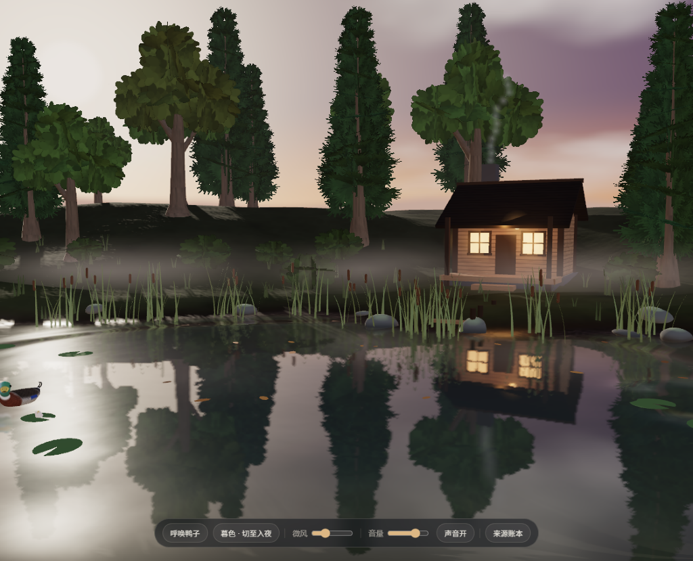
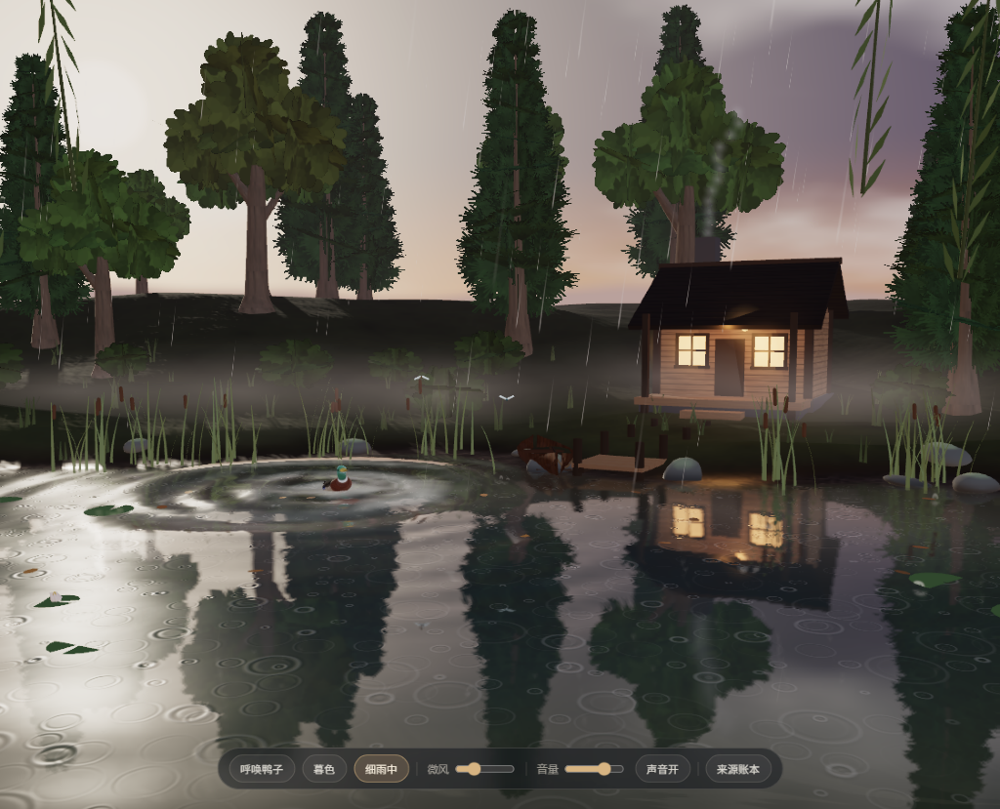
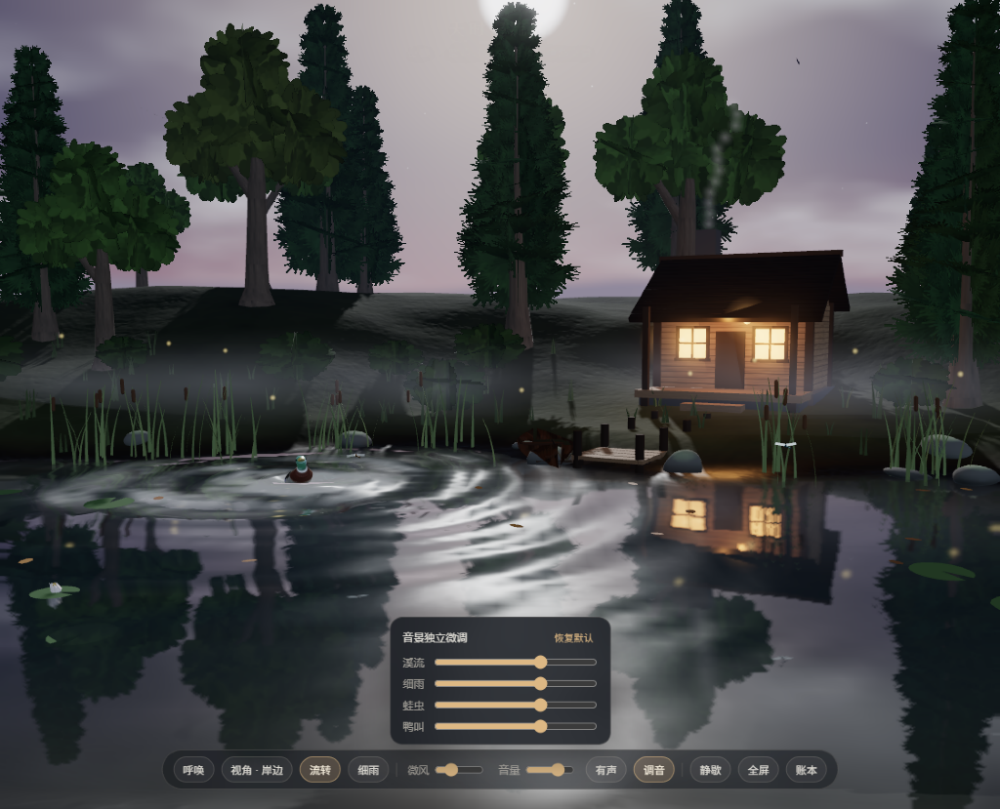
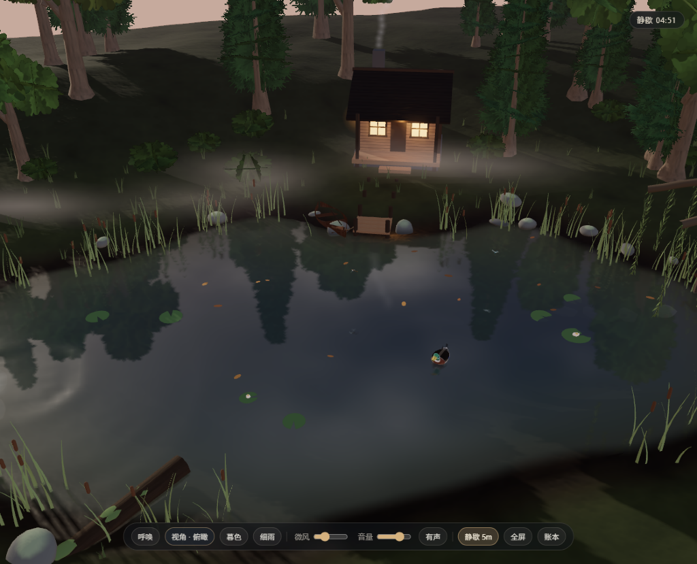

# 暮色池塘 · Twilight Pond

> 一处可以随时打开、挂在副屏的 360° 实时自然池塘空间。  
> 零目标、零任务，只有轻柔暮色、流动波纹、一只安静巡游的绿头鸭，和一点克制的自然回应。

**在线体验（GitHub Pages）**：[https://yydshly.github.io/twilight-pond/](https://yydshly.github.io/twilight-pond/)



---

## 实景效果一览

| 暮色细雨 · 像素级雨点同心环与小木舟 | 蓝调流转 · 四轨独立音景微调 |
| :---: | :---: |
|  |  |

| 360° 林梢俯瞰 · 四周岸线与静歇计时 |
| :---: |
|  |

---

## 场景设定与体验定位

- **使用时刻**：想暂时歇一会儿，或工作时挂在副屏，看看自然环境、获得一点轻回应。
- **主情绪**：安静、松弛，带一点好奇与陪伴感。
- **360° 全环景自然元素**：
  - **北岸**：暖灯雪松木屋、微弱炊烟、入水木栈桥与随水波轻晃的系泊小木舟；
  - **西岸**：苔藓乱石森林小溪入水口，持续向池塘注入自然流动水纹；
  - **东岸**：扎根坡地的完整垂柳、林下木长椅与苔藓踏石；
  - **南岸**：外围松林环抱与苔藓倒木，360° 任意角度环看均无穿帮；
  - **池塘生态**：无缝放样 3D 立体收拢翼绿头鸭、2 只暮色点水蜻蜓、水下暗鱼影、盛开睡莲、漂浮秋叶、入夜萤火与远空滑翔飞鸟。

---

## 交互与快捷键指南

| 操作 | 效果 |
| :--- | :--- |
| **轻点 / 长按水面** | 轻点激起清脆小涟漪；**轻轻长按**激起更深波纹与低沉水声；绿头鸭在自然停顿后转头观察或缓游靠近 |
| **左键拖拽 / 滚轮** | 360° 无锁定环绕池塘与缩放；静观 8 秒后自动进入缓慢呼吸漂移镜头 |
| **呼唤** | 触发自然延迟回应、三共振峰模拟野生短鸭叫并引导游向近岸 |
| **视角（快捷键 `1`–`4`）** | 平滑切换 **岸边 / 栈桥 / 追鸭 / 俯瞰** 四组机位 |
| **暮色 / 入夜 / 流转** | 在暖金暮色、银蓝月夜与 **12 分钟慢流转（金暮 → 蓝调 → 月夜）** 间切换 |
| **细雨** | 平滑切换至暮雨氛围：柔化渐细雨丝、水面像素级同心雨纹、微水花冠与纯声学雨声 |
| **微风 / 音量 / 调音** | 驱动树枝、芦苇、柳丝、小舟与水面波纹；点「调音」展开 **溪流 / 细雨 / 蛙虫 / 鸭叫** 四轨独立混音 |
| **静歇** | `5 / 15 / 25` 分钟柔和计时，时间到以轻鸭鸣与淡出提示替代刺耳闹钟 |
| **全屏 / 纯粹模式（`H`）** | 一键全屏，或按 `H` 彻底隐藏底部控制条（`H` / `Esc` 恢复），按 `D` 查看实时状态 HUD |

所有环境与音频偏好均自动持久化至 `localStorage`。

---

## 架构与四大可复用底座

技术栈：**Vite + TypeScript + Three.js（WebGL2 / HalfFloat HDR + UnrealBloom）+ Web Audio API（含户外立体声卷积混响）**

| 可复用模块 | 路径 | 核心职责与适配边界 |
| :--- | :--- | :--- |
| **PBR 纹理缓存** | `src/modules/PBRTextureCache.ts` | 纹理去重、sRGB/Linear 色彩空间校验、程序化湿泥/树皮/木屋/水面法线/树叶 PBR 兜底与显存回收 |
| **水面与采样** | `src/modules/WaterSystem.ts`<br>`src/modules/PondShapeSDF.ts` | HalfFloat 实时平面倒影、`144×144` 波纹与 V 形尾流场、解析雨点同心环及 CPU 浮力采样；适配新池形只需替换 `PondShapeSDF` |
| **声音生命周期** | `src/modules/AudioLifecycleManager.ts` | 首次手势淡入、切页自动休眠、四轨独立混音、户外立体声混响、短鸭叫冷却与外部/合成双模式 |
| **来源账本** | `src/modules/AttributionLedger.ts`<br>`public/assets/ledger.json` | 统一记录 CC BY 4.0 / CC BY 3.0 署名、来源链接与修改说明，并自动渲染至页面「账本」弹窗 |

---

## 本地运行与构建

```bash
npm install
npm run dev      # 本地开发预览 http://127.0.0.1:5173/
npm run build    # TypeScript 类型检查 + 生产构建至 dist/
```

## 替换外部 CC BY 素材

项目默认完全离线可运行（内置连续放样绿头鸭与 Web Audio 自然声景）。将真实外部素材放入以下路径并更新 `public/assets/ledger.json` 的署名与修改说明，即可自动无缝替换：

- 绿头鸭模型（CC BY 4.0）：`public/assets/models/mallard.glb`（无原生骨骼也可自动叠加运行时顶点微变形）
- 夜间蛙虫录音（CC BY 3.0）：`public/assets/audio/frogs_insects.mp3`
- 自然溪流录音：`public/assets/audio/stream.mp3`
- 短鸭叫录音：`public/assets/audio/duck_quack.mp3`
